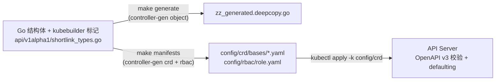

# Day 4 — Shortlink CRD：spec / status 设计与「单源真相链」

> 本日交付覆盖 ROADMAP 的 Day 4 + Day 5 范围（spec 设计 + status 设计 + 校验/defaulting + 集群实测）。
> 提交：`e0431fd`

## 一、交付清单

| 产出 | 位置 | 说明 |
|------|------|------|
| CRD 类型定义 | `api/v1alpha1/shortlink_types.go` | spec(7 字段) + status(4 字段)，全部带 kubebuilder 标记 |
| DeepCopy 代码 | `api/v1alpha1/zz_generated.deepcopy.go` | `make generate` 生成，**手改无效** |
| CRD YAML | `config/crd/bases/shortlink.dev_shortlinks.yaml` | `make manifests` 生成，**手改无效** |
| 示例 CR | `config/samples/shortlink_v1alpha1_shortlink.yaml` | 可 apply |
| RBAC | `config/rbac/role.yaml` | 自动生成（shortlink.dev 组） |
| Windows 补丁模块 | `third_party/controller-runtime/` | 上游 envtest 在 Windows 编译失败，见第六节 |
| 集群实测 | k3d operator-demo | CRD 已安装、默认值/校验/子资源行为全部验证 |

## 二、API 组与命名

- **项目域改了一次**：脚手架最初 `--domain shortlink.dev --group shortlink` 得到冗余的
  `shortlinks.shortlink.shortlink.dev`。趁 Day 4 刚建、没有下游依赖，把 `PROJECT` 的 domain
  改成 `dev` 后重新脚手架，得到干净的 **`shortlinks.shortlink.dev`**（group = `shortlink.dev`）。
  此时改成本最低；等到 Day 20 再改就要动 RBAC/samples/文档/CI 一堆引用。
- `+kubebuilder:resource:shortName=sl,categories=shortlink`：`kubectl get sl` 即可查。

## 三、spec 设计（用户写「想要什么」）

| 字段 | 类型 | 标记 | 为什么这样设计 |
|------|------|------|----------------|
| `replicas` | `*int32` | `default=1, Minimum=0` | **指针**：区分「未设置」（落 default=1）与「显式 0」（缩容到 0）。`int32` 的 Go 零值 0 无法表达这两种语义 |
| `image` | `string` | `required, MinLength=1` | 唯一必填。**不给 default**：镜像版本是用户意图，控制器不该替用户猜 |
| `port` | `int32` | `default=8080, Minimum=1, Maximum=65535` | 端口范围由 schema 在准入期拦掉 |
| `serviceType` | `corev1.ServiceType` | `default=ClusterIP, Enum=ClusterIP;NodePort;LoadBalancer` | **Enum 而非自由字符串**：非法值在 `kubectl apply` 当刻被拒，而不是等到控制器调和才炸 |
| `baseDomain` | `string` | `Pattern=域名正则` | 粗校验；DNS 可用性只能靠运行时探测（校验分层见第五节） |
| `env` | `[]corev1.EnvVar` | `+listType=map, +listMapKey=name` | **map 语义**：以 name 为键合并，多人/多控制器各改一个变量时不互踩整张列表 |
| `resources` | `corev1.ResourceRequirements` | — | 复用核心类型，不自造轮子 |
| `paused` | `bool` | `default=false` | 故障演练/排障开关：为 true 时控制器只维护 status 不推进资源 |

**spec 禁区**：观测类字段（当前副本数、Pod IP、健康度、时间戳）绝不进 spec。
它们属于「真实状态」，进 spec 会污染用户声明，且控制器写 spec 与用户改 spec 互相覆盖（写放大）。

## 四、status 设计（控制器写「现在是啥样」）

| 字段 | 类型 | 为什么 |
|------|------|--------|
| `conditions` | `[]metav1.Condition` | 标准条件列表，`listType=map + listMapKey=type` |
| `observedGeneration` | `int64` | **spec/status 因果链**：只有 `== metadata.generation` 时 conditions 才代表最新 spec 已被处理完 |
| `readyReplicas` | `int32` | 来自 API Server（Deployment.status.readyReplicas）的**真实观测**，不是本地计数（多副本 manager / 重启会漂） |
| `url` | `string` | 访问入口（ClusterIP 为集群内地址，NodePort/LoadBalancer 为对外地址） |

刻意**不用自定义 `Phase` 字符串**：单个阶段字段是漏抽象——无法表达「Ready 且 Progressing」并存、
无法携带 reason/message/时间戳，也不被任何工具链识别。`metav1.Condition` 是唯一现代写法。

## 五、单向生成链（Go 是唯一真源）



- **方向单向**：Go 结构体是唯一事实源；生成的 YAML/DeepCopy 是纯产物。手改 `config/crd/bases/*.yaml`
  后一旦再跑 `make manifests` 就被覆盖（Day 3 面试题 Q2 的「单向」就指这里）。
- **校验分层**（这是 SRE 面试常考的三层）：
  1. **CRD OpenAPI schema**（本日完成）：静态、单字段校验，API Server 准入期执行，不依赖控制器；
  2. **admission webhook**（Day 33+ 计划）：跨字段/动态校验（如「NodePort 时才允许某字段」），需要证书与部署；
  3. **控制器运行时校验**：最后兜底（如探测失败），只能降级 status 报错，不能拦写入。
- **自检答案**：「apply 非法 CR 被 API Server 拒绝」= 第 1 层生效，见下节实测。

## 六、集群实测（k3d operator-demo，全部真实输出）

### 6.1 CRD 安装与 explain

```
$ kubectl apply -k config/crd
customresourcedefinition.apiextensions.k8s.io/shortlinks.shortlink.dev created

$ kubectl get crd shortlinks.shortlink.dev
NAME                       GROUP           KIND      SHORT  SCOPE
shortlinks.shortlink.dev   shortlink.dev   Shortlink [sl]   Namespaced

$ kubectl explain shortlink.spec   # 字段齐全；serviceType 明示 enum 取值
  serviceType <string>  enum: ClusterIP, NodePort, LoadBalancer
  image       <string>  -required-
```

### 6.2 defaulting（API Server 侧默认值，不是控制器填的）

只写必填 `image`，apply 后 spec 被补全：

```
$ kubectl apply -f - <<EOF   # 仅 {"image":"..."}
$ kubectl get sl defaults-demo -o jsonpath='{.spec}'
{"image":"ghcr.io/...","paused":false,"port":8080,"replicas":1,"serviceType":"ClusterIP"}
```

`replicas:1 / port:8080 / serviceType:ClusterIP / paused:false` 全部由 CRD default 补齐。

### 6.3 校验拒绝（3 个负例，全部在准入期被拦，错误信息来自 API Server）

```
$ kubectl apply -f crd-bad-replicas.yaml
The Shortlink "bad-replicas" is invalid: spec.replicas: Invalid value: -1:
  spec.replicas in body should be greater than or equal to 0

$ kubectl apply -f crd-bad-servicetype.yaml
The Shortlink "bad-servicetype" is invalid: spec.serviceType: Unsupported value:
  "LoadBalancer-typo": supported values: "ClusterIP", "NodePort", "LoadBalancer"

$ kubectl apply -f crd-bad-no-image.yaml
The Shortlink "bad-no-image" is invalid: spec.image: Required value
```

### 6.4 status 子资源行为（Day 3 面试题 Q2 的「API Server 行为角度」，实测补全）

```
gen=1  →  （/status 端点写 spec.replicas=7 + status.url=...）
spec.replicas=1  status.url=http://ignored.spec.in.status     # spec 变更被忽略，status 写入生效

（主端点写 spec.replicas=9 + status.url=...）
spec.replicas=9  status.url=http://ignored.spec.in.status     # status 变更被忽略，spec 写入生效

（只见 status 写）gen=1  →（改 spec）gen=2                    # generation 只在 spec 变化时递增
```

结论（三条，面试直接背）：
1. **双端点隔离**：主端点丢弃 `.status` 变更、`/status` 端点丢弃 `.spec` 变更 → 控制器不会覆盖用户的 spec，用户也写不进 status；
2. **RBAC 可分离**：`shortlinks` 与 `shortlinks/status` 是两个 resource 权限点，可做到「用户写 spec、控制器写 status」；
3. **generation 语义**：status 变化不递增 generation → 配合 `GenerationChangedPredicate` 可过滤「自己写 status 引发的自激调和」。
   注意：事件仍会送达 informer（watch 不分端点），只是 generation 不变——Day 3 你答的「事件不被放行」不准确，正确说法是「generation 不变 + 谓词过滤」。

### 6.5 printcolumn

```
$ kubectl get sl
NAME               READY   REPLICAS   URL   AGE
defaults-demo                               12s
shortlink-sample                            12s
```

status 为空所以 READY/REPLICAS/URL 空列；Day 6 控制器写入 status 后自然有值。

## 七、环境坑（Windows 专供，Day 5 envtest 的拦路虎，已排掉）

1. **controller-runtime v0.25.x envtest 在 Windows 编译失败**（本日实测）：
   `signal_windows.go` 的 `func signalProcess` 与 `process.go:132` 的 `var signalProcess`
   重复声明，且 `signalProcessImpl` 未定义（只在 unix/other 构建标签下存在）。
   上游 v0.25.1、v0.25.2（2026-09-30 最新）均未修；本机 github.com 被 DNS 劫持无法核对 main。
   **处理**：`third_party/controller-runtime/` 为逐字节副本，仅把 windows 函数改名
   `signalProcess` → `signalProcessImpl`（1 个标识符），`go.mod` 加 `replace` 指向本地。
   验证：`go vet ./...`、`go test ./internal/controller/...`（编译含 envtest）均通过。
   上游修好后删掉 replace + 升级即可（详见 `third_party/controller-runtime/README.md`）。
2. **Makefile PKG_PATHS 第二次踩坑**：Day 3 修了 `paths="./..."` 把模块根当包加载的问题；
   本日 `api/` 目录出现后，`paths=./api/...` 又把 `api/` 自身（无 .go 文件）当包加载。
   最终改为 `find` 枚举「真正含 .go 文件的目录」逐个精确加载，一劳永逸。
3. **kubebuilder 脚手架后置任务**：`create api` 默认会跑 `make generate`，失败会回滚报错；
   用 `--make=false` 手动跑 `make manifests generate` 更可控。

## 八、给面试官的一句话总结

```
一个 CRD = Go 结构体（唯一真源）+ 标记（schema/子资源/打印列）
          → controller-gen 单向生成 CRD YAML
          → API Server：静态校验 + 默认值 + status 双端点隔离
控制器只读 spec、只写 status；spec/status 用 observedGeneration 建立因果链。
```

下一步：Day 5 控制循环（Deployment/Service 调和 + envtest 单测）。
